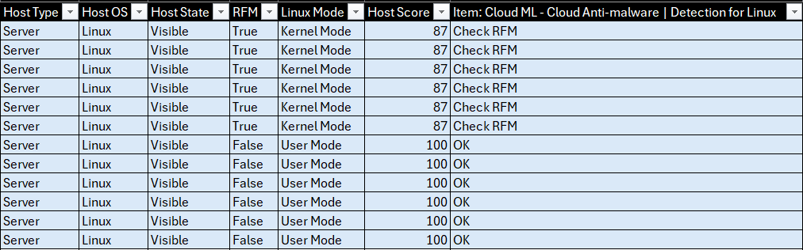

# Crowdstrike Prevention Health Sensor

> A reporting tool that audits the **sensor & prevention health** of every CrowdStrike-protected host using the **Zero Trust Assessment** signals, producing a per-OS snapshot of which protection features are enabled, degraded, or in **Reduced Functionality Mode (RFM)**.

---

## Overview

A CrowdStrike sensor is only as effective as the protection features actually enabled on it. Policies drift, hosts fall into **Reduced Functionality Mode**, and individual prevention controls silently fail — leaving endpoints that *look* protected but aren't.

This tool queries the Falcon platform for every managed host and cross-references it with the host's **Zero Trust Assessment**, turning each sensor signal into a simple, auditable verdict — **OK** or **ATTENTION** — and exporting one report per operating system. The result is an at-a-glance view of prevention posture across the fleet, so degraded sensors can be found and fixed before they matter.

---

## How It Works

The toolkit runs a single script that stitches together two Falcon data sources:

- **Stage 1 — Inventory.** The **Hosts API** lists every managed device and pulls its core metadata (hostname, type, OS, hidden state, RFM flag, Linux sensor mode).
- **Stage 2 — Assessment.** The **Zero Trust Assessment API** is queried in chunks of up to **1000 AIDs** per call, returning each host's `sensor_config` score and the per-signal results. Every signal is normalized to `OK` / `ATTENTION`, with special handling for RFM:
  - The **RFM signal** itself is the root cause — `OK` when in full functionality, `ATTENTION` otherwise.
  - A **Linux host in RFM** marks every other item as `Check RFM`, since RFM is the underlying reason any of them would fail.
- **Stage 3 — Export.** Hosts are grouped by OS and written to one CSV per platform, dropping signal columns that don't apply to that OS and filling missing values with `-`.

> 🧩 **Signals are OS-specific.** Windows, macOS, and Linux each expose a different set of sensor signals, so each report carries its own columns — that's why the output is split per OS rather than one combined file.

> 🐧 **RFM is more severe on Linux.** It leaves many capabilities non-functional, and remediation usually means fixing the **kernel**, fixing the **OS**, or switching the sensor from **Kernel Mode** to **User Mode**:
> - **User Mode** — hosts running in User Mode on Linux sensor **7.15 and later** include detection and prevention capabilities equivalent to Kernel Mode, so a User Mode sensor on a supported version is *not* a coverage gap.
> - **Kernel Mode** — when the sensor is in Kernel Mode, RFM can often be fixed quickly by reattaching the backend and restarting the service:
>
> ```bash
> sudo /opt/CrowdStrike/falconctl -s --backend=auto
> sudo systemctl restart falcon-sensor
> ```

---

## Requirements

- **CrowdStrike Falcon** with **Zero Trust Assessment** enabled
- A Falcon **API client** with **Hosts** and **Zero Trust Assessment** read scopes

---

## Setup

### 1. Environment and dependencies

```bash
# Virtual environment
python -m venv .venv
.venv\Scripts\Activate.ps1      # Windows (PowerShell)
source .venv/bin/activate        # Linux / macOS

# Install dependencies
pip install -r Scripts/requirements.txt
```

| Dependency | Purpose |
|---|---|
| `crowdstrike-falconpy` | Official CrowdStrike Falcon SDK (Hosts + Zero Trust Assessment APIs) |
| `python-dotenv` | Loads API credentials from `.env` |

### 2. API credentials

Create `Scripts/.env` with a Falcon API client that has **Hosts** and **Zero Trust Assessment** read scopes:

```env
CLIENT_ID="your-falcon-client-id"
SECRET_ID="your-falcon-client-secret"
```

> ⚠️ **Never commit `.env`.** Add it to `.gitignore`. If credentials were ever committed, revoke and rotate them in the Falcon console.

---

## Usage

The toolkit is a single script — run it to generate the current month's reports:

### `Generate_Prevention-Health-Sensor.py` — inventory, assess, and export

Lists every managed host, enriches each with its Zero Trust Assessment signals, normalizes them to `OK` / `ATTENTION`, and writes one CSV per OS.

```bash
python Scripts/Generate_Prevention-Health-Sensor.py
```
→ `Datas/<MM-YYYY>/Windows_Prevention-Health-Sensor.csv`
→ `Datas/<MM-YYYY>/Mac_Prevention-Health-Sensor.csv`
→ `Datas/<MM-YYYY>/Linux_Prevention-Health-Sensor.csv`

> 🔧 Device inventory is capped at `filter_limit` (**5000** hosts) at the top of Part 2 — raise it if your fleet is larger.
>
> ✅ Reports are generated only for the operating systems in `target_os` (**Windows, Mac, Linux**).

**Suggested cadence:** run **monthly** — output is bucketed into a `MM-YYYY` folder, so each run produces a fresh dated snapshot of fleet posture.

---

## Report Fields

Each `<OS>_Prevention-Health-Sensor.csv` carries the host metadata plus one column per sensor signal:




| Field | Description |
|---|---|
| `Host Id` | Falcon device/agent id (AID) |
| `Host Name` | Hostname |
| `Host Type` | Product type (Workstation / Server / …) |
| `Host OS` | Platform (Windows / Mac / Linux) |
| `Host State` | Visibility state (e.g. `Normal`, `Hidden`) |
| `RFM` | `True` if the host is in Reduced Functionality Mode |
| `Linux Mode` | Linux sensor mode *(Linux reports only)* |
| `Host Score` | Sensor configuration score from the assessment |
| `Item: <signal>` | Per-signal verdict: `OK`, `ATTENTION`, or `Check RFM` |

> Empty / non-applicable values are written as `-`.

---

## File Structure

```
Crowdstrike-Prevention-Health-Sensor/
├── Scripts/
│   ├── Generate_Prevention-Health-Sensor.py   # Inventory + assessment + per-OS export
│   ├── .env                                    # Falcon API credentials (not committed)
│   └── requirements.txt
├── Datas/
│   └── <MM-YYYY>/                              # Generated monthly reports, one CSV per OS
└── Files/
    └── prevention-health-report.png           # Example: generated prevention health report
```

---

## Roadmap / Next Steps

- **Trend over time** — compare consecutive monthly snapshots to highlight hosts whose posture *degraded* since the last run.
- **Alerting** — push hosts with `ATTENTION` signals or active RFM to a ticket / chat channel instead of a static CSV.
- **Combined dashboard** — feed the per-OS reports into a single view for fleet-wide prevention coverage metrics.

---

## License

This toolkit is provided as-is for reference and reuse. Adapt it freely to your environment.
